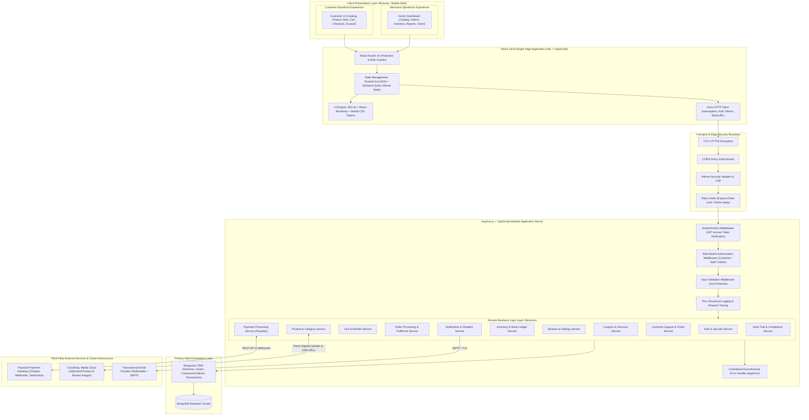
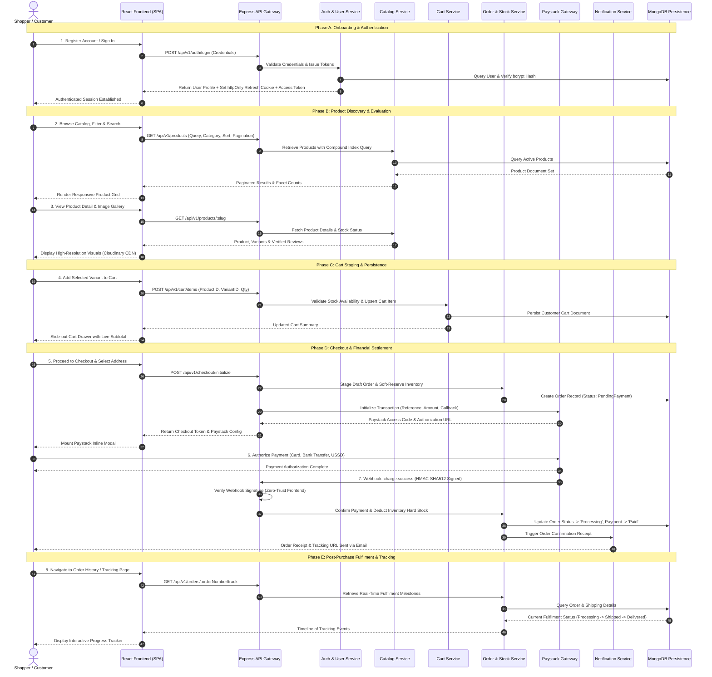

# Cartiva Mini — System Architecture Specification

**Document Version:** 1.0.0  
**Phase:** Phase 1: Project Discovery, Architecture & Technical Planning  
**Date:** November 2026  
**Author:** Senior Full-Stack Software Architect & Application Security Lead  
**Classification:** Technical Architecture Deliverable

---

## 1. System Overview & Architectural Paradigm

Cartiva Mini is designed as a high-performance, modular full-stack e-commerce platform. It provides seamless shopping, ordering, and customer management capabilities for shoppers, accompanied by a comprehensive administrative dashboard for store managers, inventory controllers, and support personnel.

### The Modular Monolith Strategy

Rather than adopting premature distributed microservices—which introduce network latency, distributed transaction complexities, deployment overhead, and data consistency challenges—Cartiva Mini utilizes a **Modular Monolith** architecture:

1. **Unified Codebase & Single Deployment Boundary:** Frontend and backend reside within a single synchronized repository with a single root `package.json`, unified dependency resolution, and coordinated build pipelines.
2. **Domain-Driven Module Boundaries:** The backend is organized into strictly decoupled domain modules (Auth, Users, Products, Categories, Cart, Wishlist, Orders, Payments, Inventory, Reviews, Coupons, Shipping, Support, Audit). Each module encapsulates its own controllers, services, models, validators, and route handlers.
3. **Internal Decoupling with Shared Contracts:** Modules communicate internally through well-defined service interfaces rather than raw database cross-queries, paving the way for effortless microservice extraction if future platform scale warrants it.
4. **Shared Type System:** A dedicated `shared/types` directory guarantees that TypeScript interfaces for request/response payloads, domain entities, enums, and validation schemas remain 100% synchronized across client and server.

---

## 2. High-Level System Architecture Diagram

The diagram below illustrates the end-to-end component topology, data flows, security boundaries, and external third-party integrations comprising the Cartiva Mini ecosystem.



---

## 3. Customer Shopping Journey Architecture Diagram

The sequence below details the transactional and communicative states throughout the customer lifecycle from initial discovery to delivery tracking.



---

## 4. Frontend Architecture Specifications

The frontend application is constructed with **React 18/19**, **TypeScript**, and **Vite**, adhering to modern component composition patterns, strict typing, and high visual polish.

### 4.1 Component & Styling Engine Strategy

- **Material-UI (MUI v6):** Serves as the primary enterprise component foundation for accessible interactive components (Dialogs, Menus, Selects, Autocomplete, Data Tables, Snackbars, and Rating widgets).
- **Bootstrap 5 & React-Bootstrap:** Utilized for rapid responsive 12-column grid structures, containers, layout scaffolding, and utility-friendly flexbox primitives.
- **Vanilla CSS Design Tokens (`index.css`):** Defines CSS custom properties (variables) for consistent typography, curated modern color palettes (deep slates, vibrant accents, dark mode variations), glassmorphic backdrops, smooth transitions, and box-shadow elevations.
- **Tailwind CSS Exclusion:** Tailwind CSS is strictly excluded in adherence to project directives. All styling is encapsulated via CSS Modules, Styled Components/MUI sx system, and Vanilla CSS token classes.

### 4.2 State Management Architecture

The client-side state is systematically separated into two distinct paradigms:

1. **Server State (TanStack Query / React Query):**
   - Manages asynchronous remote data, caching, background invalidation, and optimistic UI updates.
   - Handles product catalog queries, customer profile data, order history, and review listings with automatic deduplication.
2. **Client/Application State (Zustand):**
   - Manages synchronous, transient UI states.
   - Dedicated lightweight stores:
     - `authStore`: User identity, token status, permissions, login modals.
     - `cartStore`: Local cart drawer open/close state, optimistic item counters.
     - `uiStore`: Theme preference (light/dark), mobile navigation drawer, active toasts.
     - `checkoutStore`: Step wizard progress, selected shipping address ID, coupon state.

### 4.3 Form Management & Validation

- **React Hook Form:** Uncontrolled component performance with minimal re-renders.
- **Zod Schema Resolvers:** Form inputs are validated against isomorphic Zod schemas shared directly with the backend, guaranteeing validation parity between client feedback and server rejection.

---

## 5. Backend Architecture Specifications

The backend server is engineered as a structured, scalable **Express.js + TypeScript** application built on clean architectural patterns.

### 5.1 Layered Architecture Pattern

Each domain feature follows a strict four-layer separation:

```
Routes Layer (HTTP Method + URL Pattern + Middlewares)
      │
      ▼
Controller Layer (HTTP Request Parsing + Zod Validation Trigger + Response Envelope)
      │
      ▼
Service Layer (Pure Business Logic + Transactions + Orchestration + Third-party APIs)
      │
      ▼
Persistence Layer (Mongoose Schemas + Custom Static Methods + DB Compound Indexes)
```

### 5.2 Middleware Pipeline Execution Order

1. **Correlation / Request ID Middleware:** Injects unique `X-Request-ID` into every incoming request for distributed tracing across logs.
2. **Security Headers (Helmet):** Configures strict Content Security Policy (CSP), HTTP Strict Transport Security (HSTS), X-Frame-Options (`DENY`), and X-Content-Type-Options (`nosniff`).
3. **Cross-Origin Resource Sharing (CORS):** Restricts origins strictly to configured `FRONTEND_URL` with credentials support (`Access-Control-Allow-Credentials: true`).
4. **Rate Limiting:** Protects the platform against brute-force attacks and volumetric DDoS. Tiered limits apply to authentication, general API, and webhook routes.
5. **Raw Body Parser (Paystack Webhooks Only):** Preserves raw byte buffers for cryptographic HMAC-SHA512 webhook signature verification.
6. **JSON Body Parser & URL Encoding:** Safely parses incoming JSON with a 1MB payload ceiling.
7. **Pino HTTP Logging:** Emits structured JSON log lines containing HTTP method, path, response status, duration in milliseconds, and correlation ID.
8. **Authentication (JWT Guard):** Validates Bearer access tokens from the `Authorization` header, extracts user context, and attaches `req.user`.
9. **Role-Based Access Control (RBAC Guard):** Verifies that `req.user.role` meets required permissions (e.g., `Customer`, `Staff`, `Admin`).
10. **Validation Middleware:** Evaluates `req.body`, `req.query`, and `req.params` against domain-specific Zod schemas before reaching the controller.
11. **Global Error Handler:** Catches all synchronous and asynchronous errors, normalizes them into standard JSON error envelopes, logs stack traces securely, and masks sensitive internals in production (`NODE_ENV === 'production'`).

---

## 6. Data Integrity & Transactional Consistency

In e-commerce, race conditions on inventory stock and fraudulent payment reporting represent existential risks. Cartiva Mini enforces strict integrity protocols:

1. **MongoDB Two-Phase Locking / ACID Transactions:** Checkout order creation and stock decrements execute within an atomic MongoDB Session (`startSession()`, `withTransaction()`).
2. **Stock Reservation & Expiry:** Upon checkout initiation, inventory is placed in a "soft-reserved" state with a 15-minute Time-To-Live (TTL). If payment fails or times out, the reservation is released back to available stock.
3. **Idempotent Webhook Processing:** Every Paystack webhook delivery is logged with its unique `event_id` and reference. Duplicate delivery attempts are immediately acknowledged with `200 OK` without re-executing business logic.
4. **Zero-Trust Client Payment Reporting:** The frontend client can never mark an order as "Paid". Payment verification requires:
   - Direct backend HTTPS call to Paystack's `/transaction/verify/:reference` endpoint, OR
   - Cryptographically verified Paystack webhook (`X-Paystack-Signature` matching HMAC-SHA512 of raw body with `PAYSTACK_SECRET_KEY`).

---

## 7. Operational & Telemetry Strategy

- **Structured Logging (Pino):** Zero-overhead JSON logging with configurable log levels (`debug`, `info`, `warn`, `error`, `fatal`). In development, output is piped through `pino-pretty`.
- **Health & Readiness Probes:** Endpoints at `/health/liveness` and `/health/readiness` check process vitality and MongoDB connection status for container orchestrators.
- **Graceful Shutdown:** Intercepts `SIGINT` and `SIGTERM` signals, closes active HTTP listeners, allows ongoing database transactions to finish cleanly within a 10-second timeout, and gracefully closes MongoDB connections.
