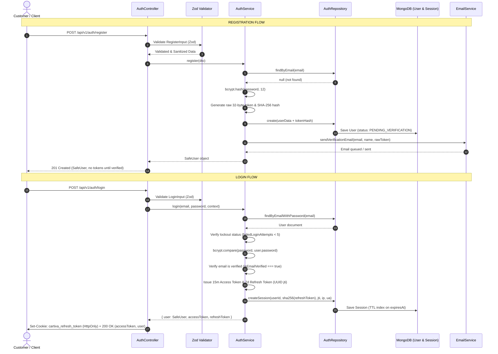

# CARTIVA MINI — AUTHENTICATION ARCHITECTURE

## 1. System Overview & Core Principles

Cartiva Mini implements a production-grade, enterprise-standard authentication and authorization system built with **Node.js, Express, TypeScript, MongoDB (Mongoose), JSON Web Tokens (JWT), bcrypt, and Zod**.

The system is designed with defense-in-depth security principles:

1. **Deny by Default:** No endpoint is accessible without explicitly granted permissions.
2. **Dual-Token Architecture:** Short-lived access tokens (15 minutes) coupled with rotatable, revocable refresh tokens (7 days).
3. **Zero Plaintext Storage:** Passwords hashed with bcrypt (cost factor 12); refresh tokens and verification tokens stored as cryptographic SHA-256 hashes.
4. **Token Isolation:** Access tokens remain strictly in application memory; refresh tokens are transported exclusively via `HttpOnly`, `SameSite=Lax`, `Secure` (in production) cookies.
5. **Replay Detection & Breach Containment:** If a previously used refresh token is presented, all active sessions for that user are immediately purged.
6. **Account Enumeration Defense:** Sensitive recovery and registration queries return timing-conscious, generic status messages.
7. **Active Brute-Force Lockout:** Account locking occurs after 5 consecutive failed login attempts (30-minute lockout window).

---

## 2. High-Level Architecture Diagram

---

## 3. Modular Component Responsibilities

The authentication domain is structured within a strict, decoupled module hierarchy (`backend/src/modules/auth/`):

| File                 | Architectural Role       | Responsibilities                                                                                                                                      |
| -------------------- | ------------------------ | ----------------------------------------------------------------------------------------------------------------------------------------------------- |
| `auth.constants.ts`  | Configuration & Policies | Token lifespans (15m access, 7d refresh, 24h email, 1h reset), bcrypt salt rounds (12), lockout thresholds (5 attempts, 30m lock), cookie attributes. |
| `auth.types.ts`      | Domain Type Contracts    | Internal JWT payloads (`JwtAccessPayload`, `JwtRefreshPayload`), authenticated context interfaces (`AuthenticatedUser`).                              |
| `auth.validator.ts`  | Boundary Validation      | Zod schemas enforcing strict sanitization, password complexity regex (uppercase, lowercase, number, symbol), and confirmation matching.               |
| `auth.repository.ts` | Data Layer Encapsulation | Isolated Mongoose query operations on `User` and `Session` collections. Strict projection prevents password hash leakage.                             |
| `auth.service.ts`    | Business Logic Engine    | Hashing, token issuance, rotation logic, replay detection, password reset execution, account lockout enforcement.                                     |
| `auth.controller.ts` | HTTP Transport Layer     | Express request unwrapping, DTO routing, cookie parsing/setting (`cartiva_refresh_token`), standardized response generation.                          |
| `auth.routes.ts`     | Routing & Policy Mapping | Rate-limit bindings, middleware pipelines (`authenticate`, `requireRole`), and OpenAPI documentation integration.                                     |

---

## 4. Cryptographic Specifications

### 4.1 Password Hashing

- **Algorithm:** `bcrypt` (via `bcryptjs`).
- **Cost Factor:** `12` rounds (balanced between cryptographic resistance against GPU acceleration and sub-200ms server response times).
- **Projections:** User model specifies `select: false` on the `password` field by default. Password hashes are only retrieved through dedicated repository queries using explicit `.select('+password')`.

### 4.2 Token Generation & Signatures

- **Signing Algorithm:** `HMAC-SHA256` (`HS256`).
- **Secrets Separation:**
  - Access Tokens: `JWT_ACCESS_SECRET` (distinct 32+ character entropy string).
  - Refresh Tokens: `JWT_REFRESH_SECRET` (distinct 32+ character entropy string).
- **Collision Resistance:** Refresh tokens embed a cryptographically secure random UUID (`jti: crypto.randomUUID()`), guaranteeing that tokens generated within the same second have unique signatures.

### 4.3 Opaque Verification & Reset Tokens

- **Generation:** `crypto.randomBytes(32).toString('hex')` producing a 64-character unguessable hex string sent to the user.
- **Database Storage:** Stored strictly as a SHA-256 digest (`crypto.createHash('sha256').update(rawToken).digest('hex')`). Database breaches expose zero usable reset or verification tokens.

---

## 5. Brute-Force & Credential Stuffing Defenses

To prevent dictionary and brute-force attacks against customer credentials:

1. **Endpoint Rate Limiting:** Dedicated `authRateLimiter` restricts login attempts to `10 requests per 15-minute window` per IP address.
2. **Account Lockout:**
   - 5 consecutive failed login attempts trigger an automatic account lockout.
   - Lock duration: 30 minutes (`lockUntil = Date.now() + 30 * 60 * 1000`).
   - If an account is locked, the request is rejected with HTTP 401 (`ACCOUNT_LOCKED`) stating the remaining lockout time.
   - Successful login resets `failedLoginAttempts: 0` and `lockUntil: null`.
3. **Generic Error Messages:** Failed logins return `Invalid email or password.` regardless of whether the email address was registered, eliminating account enumeration vectors.
