# Cartiva Mini — Database Relationships & Entity Relationship Diagram (ERD)

**Document Version:** 1.0.0  
**Phase:** Phase 4: MongoDB Database Architecture & Data Management  
**Date:** November 2026  
**Status:** Approved & Implemented  
**Classification:** Database Architecture Deliverable

---

## 1. Overview & Architectural Strategy

Cartiva Mini implements a hybrid **Document-Oriented Data Model** engineered using MongoDB and Mongoose. The architecture balances:

1. **Embedded Subdocuments:** Used when data has strong document ownership, is always read together with the parent, and has bounded cardinality (e.g., `OrderItems` inside `Order`, `CartItems` inside `Cart`, `TicketMessages` inside `SupportTicket`, and `ProductImages` inside `Product`).
2. **Normalized Referenced Relationships (`ObjectId` references):** Used when data requires independent lifecycles, high-volume scaling, multi-parent queries, or immutable audit tracking (e.g., `User` referenced by `Order`, `Product` referenced by `InventoryMovement`, `Order` referenced by `Payment`).
3. **Immutable Historical Snapshots:** Critical transactional and financial records (`Order`, `Payment`, `Transaction`) capture point-in-time snapshots of product titles, SKUs, unit prices, applied coupons, and delivery addresses. This guarantees that catalog edits never alter historical financial reporting.

---

## 2. Complete Entity Relationship Diagram (Mermaid)

```mermaid
erDiagram
    USERS ||--o{ ADDRESSES : "owns (1:N)"
    USERS ||--o| CARTS : "owns (1:1)"
    USERS ||--o| WISHLISTS : "owns (1:1)"
    USERS ||--o{ ORDERS : "places (1:N)"
    USERS ||--o{ REVIEWS : "authors (1:N)"
    USERS ||--o{ NOTIFICATIONS : "receives (1:N)"
    USERS ||--o{ SUPPORT_TICKETS : "opens (1:N)"
    USERS ||--o{ AUDIT_LOGS : "triggers (1:N)"

    CATEGORIES ||--o{ CATEGORIES : "parent of (1:N hierarchy)"
    CATEGORIES ||--o{ PRODUCTS : "categorizes (1:N)"

    PRODUCTS ||--o{ REVIEWS : "receives (1:N)"
    PRODUCTS ||--o{ INVENTORY_MOVEMENTS : "tracks stock (1:N)"
    PRODUCTS }o--o{ WISHLISTS : "saved in (M:N via items)"
    PRODUCTS }o--o{ CARTS : "added to (M:N via items)"

    ORDERS ||--|| PAYMENTS : "generates (1:1)"
    ORDERS ||--o{ TRANSACTIONS : "settles via (1:N)"
    ORDERS ||--o{ INVENTORY_MOVEMENTS : "triggers deduction (1:N)"
    ORDERS }o--o| COUPONS : "applies (N:1)"
    ORDERS }o--o| SHIPPING_CONFIGURATIONS : "priced by (N:1)"

    PAYMENTS ||--o{ TRANSACTIONS : "composed of (1:N)"

    USERS {
        ObjectId _id PK
        string email UK
        string passwordHash
        string firstName
        string lastName
        string phone
        enum role "customer|staff|admin"
        boolean isEmailVerified
        boolean isActive
        date createdAt
    }

    CATEGORIES {
        ObjectId _id PK
        string name
        string slug UK
        ObjectId parentId FK "self-reference"
        int displayOrder
        boolean isActive
    }

    PRODUCTS {
        ObjectId _id PK
        string title
        string slug UK
        string sku UK
        ObjectId categoryId FK
        number regularPrice
        number salePrice
        number costPrice
        int stockQuantity
        enum status "draft|active|archived|out_of_stock"
        boolean isFeatured
    }

    ADDRESSES {
        ObjectId _id PK
        ObjectId userId FK
        string recipientName
        string phone
        string addressLine1
        string city
        string state
        string country
        boolean isDefaultShipping
        boolean isDefaultBilling
    }

    CARTS {
        ObjectId _id PK
        ObjectId userId FK "unique sparse"
        string sessionId UK "sparse"
        array items "embedded CartItems"
        number subtotal
        date expiresAt "TTL index"
    }

    WISHLISTS {
        ObjectId _id PK
        ObjectId userId FK "unique"
        array items "embedded WishlistItems"
        date updatedAt
    }

    ORDERS {
        ObjectId _id PK
        string orderNumber UK
        ObjectId userId FK
        array items "embedded OrderItem snapshots"
        object shippingAddress "immutable Address snapshot"
        number subtotal
        number discountAmount
        number shippingFee
        number totalAmount
        enum orderStatus "pending|processing|shipped|delivered|cancelled|refunded"
        enum paymentStatus "pending|authorized|paid|failed|refunded"
    }

    PAYMENTS {
        ObjectId _id PK
        string paymentReference UK
        ObjectId orderId FK "unique"
        ObjectId userId FK
        enum provider "paystack|flutterwave|stripe|bank_transfer"
        number amount
        string currency
        enum status "pending|successful|failed|reversed"
    }

    TRANSACTIONS {
        ObjectId _id PK
        string transactionReference UK
        ObjectId paymentId FK
        ObjectId orderId FK
        enum type "charge|refund|reversal|payout"
        number amount
        number gatewayFee
        number netAmount
        enum status "pending|successful|failed"
    }

    REVIEWS {
        ObjectId _id PK
        ObjectId productId FK
        ObjectId userId FK
        int rating "1-5"
        string title
        string comment
        enum status "pending|approved|rejected"
        boolean isVerifiedPurchase
    }

    COUPONS {
        ObjectId _id PK
        string code UK
        enum discountType "percentage|fixed_amount"
        number discountValue
        number minOrderAmount
        int usageLimit
        int usedCount
        date startDate
        date expiryDate
        boolean isActive
    }

    INVENTORY_MOVEMENTS {
        ObjectId _id PK
        ObjectId productId FK
        enum type "restock|sale|return|adjustment|damage"
        int quantity
        int previousStock
        int newStock
        ObjectId referenceOrderId FK "optional"
        string reason
        ObjectId actorId FK "optional"
    }

    NOTIFICATIONS {
        ObjectId _id PK
        ObjectId recipientId FK
        enum type "order_update|payment_success|security_alert|marketing"
        string title
        string message
        boolean isRead
        date expiresAt "TTL index"
    }

    SUPPORT_TICKETS {
        ObjectId _id PK
        string ticketNumber UK
        ObjectId userId FK
        ObjectId orderId FK "optional"
        string subject
        enum category "order_issue|payment|technical|inquiry"
        enum priority "low|medium|high|urgent"
        enum status "open|in_progress|resolved|closed"
        array messages "embedded TicketMessages"
    }

    AUDIT_LOGS {
        ObjectId _id PK
        ObjectId actorId FK "optional"
        string actorRole
        string action
        string entity
        string entityId
        object changesDiff
        string ipAddress
        date timestamp
    }

    SHIPPING_CONFIGURATIONS {
        ObjectId _id PK
        string zoneName
        array statesCovered
        string carrierName
        enum rateCalculationType "flat|weight_tiered|free_above_threshold"
        number baseRate
        int estimatedDeliveryDaysMin
        int estimatedDeliveryDaysMax
        boolean isActive
    }
```

---

## 3. Relationship Specifications & Cardinality

### 3.1 Identity & Customer Domain

| Relationship                 | Cardinality | Implementation Strategy                 | Delete / Cleanup Policy                                |
| :--------------------------- | :---------- | :-------------------------------------- | :----------------------------------------------------- |
| `User` &rarr; `Address`      | 1 : N       | Referenced (`Address.userId`)           | Retain for historical orders; soft delete by user      |
| `User` &rarr; `Cart`         | 1 : 1       | Referenced with unique sparse index     | 30-day TTL expiration for abandoned guest carts        |
| `User` &rarr; `Wishlist`     | 1 : 1       | Referenced with unique index            | Cascade delete on account removal                      |
| `User` &rarr; `Order`        | 1 : N       | Referenced (`Order.userId`)             | Strict retention (never hard delete financial records) |
| `User` &rarr; `Notification` | 1 : N       | Referenced (`Notification.recipientId`) | 90-day automatic TTL purge                             |

### 3.2 Product Catalog Domain

| Relationship                      | Cardinality | Implementation Strategy                    | Integrity Rules                                                         |
| :-------------------------------- | :---------- | :----------------------------------------- | :---------------------------------------------------------------------- |
| `Category` &rarr; `Category`      | 1 : N       | Self-reference via `parentId`              | Custom validator blocks self-referencing (`_id !== parentId`)           |
| `Category` &rarr; `Product`       | 1 : N       | Referenced (`Product.categoryId`)          | Restrict category deletion if active products exist                     |
| `Product` &rarr; `ProductImage`   | 1 : N       | Embedded array `images` inside `Product`   | Natural document boundary; max 10 images                                |
| `Product` &rarr; `ProductVariant` | 1 : N       | Embedded array `variants` inside `Product` | SKU uniqueness enforced across parent and variants                      |
| `Product` &rarr; `Review`         | 1 : N       | Referenced (`Review.productId`)            | Compound unique index `{ productId: 1, userId: 1 }` prevents duplicates |

### 3.3 Financial & Fulfillment Domain

| Relationship                         | Cardinality | Implementation Strategy                          | Data Protection & Audit Policy                   |
| :----------------------------------- | :---------- | :----------------------------------------------- | :----------------------------------------------- |
| `Order` &rarr; `OrderItem`           | 1 : N       | Embedded subdocuments `Order.items`              | Immutable snapshot of SKU, title, and unit price |
| `Order` &rarr; `Address`             | 1 : 1       | Embedded subdocument `shippingAddress`           | Snapshot copied from Address at checkout         |
| `Order` &rarr; `Payment`             | 1 : 1       | Referenced (`Payment.orderId` with unique index) | Exactly one payment per order                    |
| `Payment` &rarr; `Transaction`       | 1 : N       | Referenced (`Transaction.paymentId`)             | Append-only double-entry financial ledger        |
| `Product` &rarr; `InventoryMovement` | 1 : N       | Referenced (`InventoryMovement.productId`)       | Append-only ledger; updates/deletions forbidden  |

### 3.4 Support & Administration Domain

| Relationship                           | Cardinality | Implementation Strategy          | Operational Purpose            |
| :------------------------------------- | :---------- | :------------------------------- | :----------------------------- |
| `SupportTicket` &rarr; `TicketMessage` | 1 : N       | Embedded subdocuments `messages` | Bounded conversation thread    |
| `SupportTicket` &rarr; `User` (Staff)  | N : 1       | Optional reference `assignedTo`  | Admin workflow routing         |
| `AuditLog` &rarr; `User` (Actor)       | N : 1       | Optional reference `actorId`     | Tamper-proof activity tracking |

---

## 4. Foreign Key Emulation & Referential Integrity Rules

MongoDB does not provide automatic foreign key cascade or restrict constraints. In Cartiva Mini, referential integrity is guaranteed through:

1. **Pre-Save Mongoose Hooks:** Enforce parent document existence (e.g., verifying `categoryId` exists prior to saving a new product).
2. **Transaction Scopes:** Checkout, payment settlement, and inventory decrements execute inside multi-document MongoDB transactions (`session.withTransaction()`).
3. **Immutability Enforcement:** Snapshots in `Order` detach customer order history from subsequent catalog updates, shielding historical receipts against product deletion or price changes.
