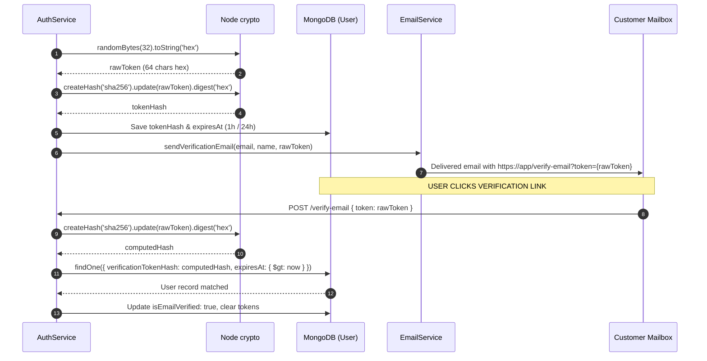

# CARTIVA MINI — EMAIL AUTHENTICATION & COMMUNICATION STANDARDS

## 1. Overview & Architecture

Cartiva Mini treats customer communication as an integral element of platform security and brand identity. The email infrastructure is managed by the centralized `EmailService` (`backend/src/services/email.service.ts`), built on **Nodemailer** with defensive fallbacks and responsive HTML templates.

The service provides:

1. **Zero-Failure Local Development & Testing:** When SMTP credentials are not yet configured or running under test environments (`NODE_ENV === 'test'`), the service simulates dispatch and outputs safe structured logs, ensuring that developers and automated CI pipelines can test authentication flows without third-party dependencies.
2. **Production-Ready SMTP Relay:** Fully compatible with enterprise email providers including SendGrid, Amazon SES, Mailgun, Postmark, or custom SMTP relays.
3. **Cryptographically Safe Token Handling:** Verification and password reset URLs embed high-entropy opaque random strings (32 bytes / 64 characters) whose SHA-256 digests are stored in the database.

---

## 2. Configuration & Environment Variables

| Variable     | Required in Prod | Example Value             | Description                                                        |
| ------------ | :--------------: | ------------------------- | ------------------------------------------------------------------ |
| `SMTP_HOST`  |       Yes        | `smtp.sendgrid.net`       | Hostname of the transactional SMTP server.                         |
| `SMTP_PORT`  |       Yes        | `587`                     | Port for SMTP (typically `587` for STARTTLS or `465` for SSL/TLS). |
| `SMTP_USER`  |       Yes        | `apikey`                  | SMTP username or API key identifier.                               |
| `SMTP_PASS`  |       Yes        | `SG.xxxxxxxxxxxx`         | Secure SMTP password or API token.                                 |
| `EMAIL_FROM` |       Yes        | `noreply@cartivamini.com` | Standard sender address displayed to customers.                    |
| `APP_URL`    |       Yes        | `http://localhost:5180`   | Frontend URL root for constructing verification links.             |

---

## 3. Security Design for Email Tokens



### 3.1 Expiration Rules

- **Email Verification Tokens:** Expire in **24 hours** (`Date.now() + 24 * 60 * 60 * 1000`).
- **Password Reset Tokens:** Expire in **1 hour** (`Date.now() + 60 * 60 * 1000`).

### 3.2 Single-Use Enforcement

Once consumed, the token hash and expiry fields on the user document are immediately set to `null` (`verificationTokenHash = undefined`, `verificationTokenExpiresAt = undefined`). Any subsequent request presenting the same token is rejected.

---

## 4. Email Communication Standards & Templates

All transactional messages follow the Cartiva Mini visual identity:

- **Primary Color:** Deep Slate Navy (`#0F172A`).
- **Accent Accent:** Cartiva Gold (`#EAB308`).
- **Typography:** System font stack (`-apple-system, BlinkMacSystemFont, 'Segoe UI', Roboto, Helvetica, Arial, sans-serif`).
- **Layout:** Fully responsive, container width capped at 600px with high-contrast call-to-action buttons.

### 4.1 Implemented Transactional Templates

1. **Email Verification (`sendVerificationEmail`):**
   - **Subject:** `Cartiva Mini — Verify Your Email Address`
   - **Body:** Welcomes the customer to Cartiva Mini, clearly states why the email was sent, and provides a prominent button to activate the account within 24 hours.
2. **Password Reset (`sendPasswordResetEmail`):**
   - **Subject:** `Cartiva Mini — Password Reset Request`
   - **Body:** Informs the user of the password reset request, provides a secure 1-hour reset button, and explicitly cautions that if the customer did not request the change, their account credentials may need reviewing.
3. **Password Changed Security Alert (`sendPasswordChangedNotification`):**
   - **Subject:** `Cartiva Mini — Security Notification: Password Changed`
   - **Body:** Alerts the customer immediately that their password was updated, indicates that existing sessions were invalidated, and provides instructions to contact security support if they did not authorize the change.

---

## 5. Account Enumeration Defense

To protect customer privacy:

- The `POST /api/v1/auth/forgot-password` endpoint returns the exact same success response whether the email exists in the database or not:
  ```json
  {
    "success": true,
    "message": "If an account associated with that email address exists, a password reset link has been dispatched.",
    "data": null
  }
  ```
- The `POST /api/v1/auth/resend-verification` endpoint likewise returns a generic confirmation message.
- Internal error traces and database lookups are suppressed from the client.
