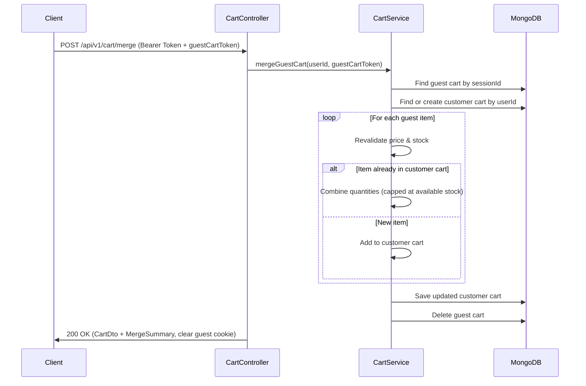

# Guest Cart and Cart Merging Architecture

## 1. Overview

Cartiva Mini enables frictionless guest shopping without requiring prior account registration. When a guest visitor later registers or logs in, their anonymous cart is seamlessly merged into their persistent authenticated customer cart.

---

## 2. Guest Cart Identification Mechanism

1. **Opaque Session Token:**
   - Guest carts use cryptographically random UUID tokens (`crypto.randomUUID()`) stored in `Cart.sessionId`.
   - Never exposes internal database IDs or predictable counter values.
2. **Transmission Channels:**
   - **HTTP Header:** `x-guest-cart-token` (and fallback `x-cart-token`).
   - **HTTP Cookie:** `cartiva_guest_cart_token` (HTTP-only, SameSite=Lax, 30-day Max-Age).
3. **Automatic Cleanup (MongoDB TTL Index):**
   - Guest carts set `expiresAt` to 30 days from creation.
   - MongoDB's background TTL monitor automatically purges abandoned guest carts without manual cron jobs.

---

## 3. Cart Merge Workflow (`POST /api/v1/cart/merge`)

When a customer authenticates, the client invokes the merge endpoint with the guest token:

### Safety & Edge Case Handling

- **Out of Stock Items:** If a guest cart item is out of stock when merging, it is excluded and reported in `mergeSummary.warnings`.
- **Publication Check:** Draft or archived items are excluded.
- **Double Merge Prevention:** The guest cart is deleted immediately upon successful merge.
- **IDOR Immunity:** Guest tokens cannot be used to read or overwrite another customer's authenticated cart.
