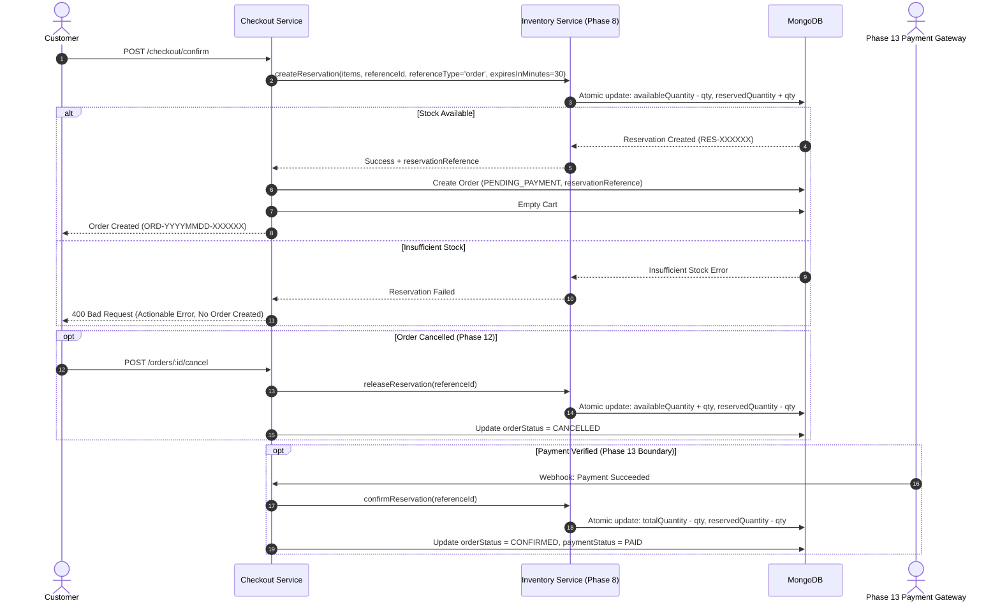

# Inventory & Order Integration — Cartiva Mini (Phase 12)

## 1. Integration with Phase 8 Inventory Architecture

Order placement in Cartiva Mini is tightly coupled to the atomic inventory reservation engine developed in Phase 8. This guarantees that:

1. Two customers can never purchase the same last in-stock physical unit simultaneously (race-condition protection).
2. Stock is not permanently deducted until payment is verified by Phase 13.
3. Abandoned or cancelled orders immediately return reserved stock to the public available pool.



---

## 2. Reservation Parameters & Lifecycle

When `checkoutService.confirmOrder` is called:

- **`referenceId`:** Order's MongoDB `_id.toString()`.
- **`referenceType`:** `'order'`.
- **`expiresInMinutes`:** `30` (giving the customer 30 minutes to complete payment authorization).
- **`items`:** Array of `{ productId, variantId, quantity }`.

### Atomic Database Lock Mechanism:

The reservation service applies MongoDB atomic filter queries:

```typescript
const filter = {
  productId,
  isInventoryTracked: true,
  availableQuantity: { $gte: requestedQuantity },
};

const update = {
  $inc: {
    availableQuantity: -requestedQuantity,
    reservedQuantity: requestedQuantity,
  },
};
```

If another transaction depleted available inventory in the millisecond between review and confirmation, the query matches 0 documents and returns an immediate reservation failure, aborting order creation without corrupting stock records.

---

## 3. Reservation Release Workflows

Reserved stock is released back into `availableQuantity` under three conditions:

1. **Self-Service Order Cancellation:** If the customer cancels an eligible order (`PENDING_PAYMENT` or `PAYMENT_FAILED`), `orderService.cancelOrder` calls `inventoryService.releaseReservation(order._id.toString())`.
2. **Administrative Cancellation:** If an administrator cancels an order from the admin dashboard, the same reservation release is triggered.
3. **Session Expiry / Abandonment:** The Phase 8 background reservation worker regularly queries `InventoryReservation` records where `status = 'active'` and `expiresAt < now()`, releasing expired reservations automatically.

---

## 4. Phase 13 Hand-Off Interface

Phase 12 leaves the order and inventory boundaries prepared for Phase 13:

```typescript
// Interface prepared for Phase 13 payment webhook handler:
async function handlePaymentSuccess(orderId: string, paymentReference: string) {
  // 1. Confirm inventory reservation into permanent deduction
  await inventoryService.confirmReservation(orderId);

  // 2. Transition order to CONFIRMED and paymentStatus to PAID
  await orderService.updateOrderStatusAfterPayment(orderId, {
    orderStatus: OrderStatus.CONFIRMED,
    paymentStatus: PaymentStatus.PAID,
    paymentReference,
  });
}
```

Phase 12 does not simulate payment success. Orders remain in `PENDING_PAYMENT` until verified by Phase 13.
