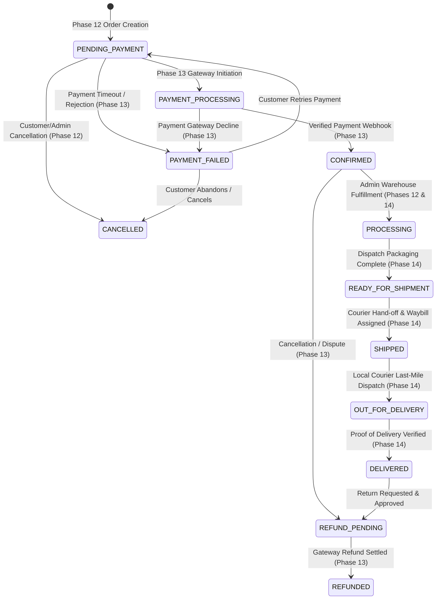

# Order Status Lifecycle & State Machine — Cartiva Mini (Phase 12)

## 1. Order Status Lifecycle

Cartiva Mini enforces a deterministic, controlled state machine for order processing. Arbitrary or out-of-sequence status transitions from clients are strictly rejected.



---

## 2. Status Definitions & Phase Responsibilities

| Order Status         | Description                                                                                       | Authoritative Managing Phase                  |
| -------------------- | ------------------------------------------------------------------------------------------------- | --------------------------------------------- |
| `PENDING_PAYMENT`    | Initial state upon checkout confirmation. Stock is atomically reserved for 30 minutes.            | **Phase 12 (Checkout & Order Processing)**    |
| `PAYMENT_PROCESSING` | Customer is interacting with Paystack payment gateway.                                            | **Phase 13 (Payment Gateway & Settlement)**   |
| `CONFIRMED`          | Payment successfully verified via server-to-server webhook. Order is queued for fulfillment.      | **Phase 13 (Payment Gateway & Settlement)**   |
| `PROCESSING`         | Warehouse staff picking and packing ordered items.                                                | **Phase 12 (Admin) / Phase 14 (Fulfillment)** |
| `READY_FOR_SHIPMENT` | Package boxed, labeled, and staged in dispatch bay.                                               | **Phase 14 (Shipping & Delivery Tracking)**   |
| `SHIPPED`            | Courier partner has collected the parcel; tracking number assigned.                               | **Phase 14 (Shipping & Delivery Tracking)**   |
| `OUT_FOR_DELIVERY`   | Parcel is in transit with the local courier driver.                                               | **Phase 14 (Shipping & Delivery Tracking)**   |
| `DELIVERED`          | Parcel received by recipient; delivery confirmation recorded.                                     | **Phase 14 (Shipping & Delivery Tracking)**   |
| `CANCELLED`          | Order terminated prior to dispatch. Any active inventory reservations are automatically released. | **Phase 12 (Self-Service & Admin)**           |
| `PAYMENT_FAILED`     | Gateway transaction timed out, was declined, or was abandoned.                                    | **Phase 13 (Payment Gateway & Settlement)**   |
| `REFUND_PENDING`     | Refund initiated after cancellation or approved return.                                           | **Phase 13 (Payment Gateway & Settlement)**   |
| `REFUNDED`           | Funds returned to customer's payment method.                                                      | **Phase 13 (Payment Gateway & Settlement)**   |

---

## 3. Validated Transition Matrix (`PERMITTED_STATUS_TRANSITIONS`)

The backend validates every status update against the immutable transition matrix defined in `backend/src/modules/order/order.constants.ts`:

```typescript
export const PERMITTED_STATUS_TRANSITIONS: Record<OrderStatus, OrderStatus[]> = {
  [OrderStatus.PENDING_PAYMENT]: [
    OrderStatus.PAYMENT_PROCESSING,
    OrderStatus.CANCELLED,
    OrderStatus.PAYMENT_FAILED,
  ],
  [OrderStatus.PAYMENT_PROCESSING]: [
    OrderStatus.CONFIRMED,
    OrderStatus.PAYMENT_FAILED,
    OrderStatus.CANCELLED,
  ],
  [OrderStatus.CONFIRMED]: [
    OrderStatus.PROCESSING,
    OrderStatus.CANCELLED,
    OrderStatus.REFUND_PENDING,
  ],
  [OrderStatus.PROCESSING]: [
    OrderStatus.READY_FOR_SHIPMENT,
    OrderStatus.CANCELLED,
    OrderStatus.REFUND_PENDING,
  ],
  [OrderStatus.READY_FOR_SHIPMENT]: [OrderStatus.SHIPPED, OrderStatus.CANCELLED],
  [OrderStatus.SHIPPED]: [OrderStatus.OUT_FOR_DELIVERY, OrderStatus.DELIVERED],
  [OrderStatus.OUT_FOR_DELIVERY]: [OrderStatus.DELIVERED],
  [OrderStatus.DELIVERED]: [OrderStatus.REFUND_PENDING],
  [OrderStatus.CANCELLED]: [], // Terminal state
  [OrderStatus.PAYMENT_FAILED]: [OrderStatus.PENDING_PAYMENT, OrderStatus.CANCELLED],
  [OrderStatus.REFUND_PENDING]: [OrderStatus.REFUNDED],
  [OrderStatus.REFUNDED]: [], // Terminal state
};
```

---

## 4. Permissions & Self-Service Cancellation Rules

1. **Customer Cancellation Eligibility:** Customers are permitted to self-cancel orders only while the order is in `PENDING_PAYMENT` or `PAYMENT_FAILED` status. Once an order enters `CONFIRMED`, `PROCESSING`, or dispatch stages, customers cannot directly cancel it from the storefront; they must contact customer support.
2. **Stock Release on Cancellation:** Whenever an order transitions to `CANCELLED`, the order service invokes `inventoryService.releaseReservation` with the order's ID, instantly restoring available inventory.
3. **No Direct Transition to `PAID`:** In Phase 12, administrators cannot manually mark orders as `PAID`. Payment state transitions are strictly delegated to Phase 13 webhook verification.
