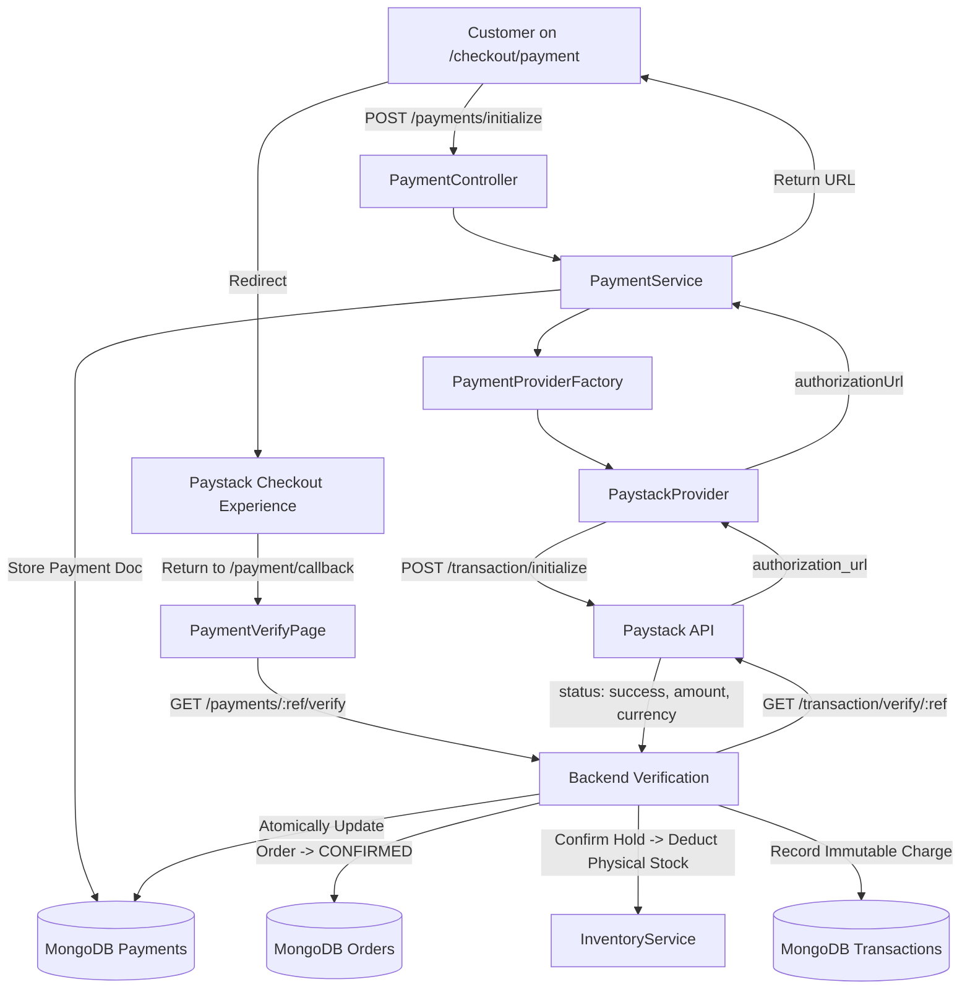

# Cartiva Mini — Payment Gateway Architecture (Phase 13)

## 1. Overview & Architectural Principles

Phase 13 integrates Cartiva Mini with **Paystack** as the primary payment gateway, adhering strictly to:
- **Provider-Independent Abstraction**: The core order, checkout, and inventory domains communicate with gateways via standard interfaces (`IPaymentProvider`), ensuring zero vendor lock-in. Additional providers (e.g., Flutterwave, Monnify, or Stripe) can be registered via `PaymentProviderFactory` without modifying checkout business logic.
- **Server-Side Financial Authority**: The client never dictates payment amount, currency, or completion status. Authoritative order amounts, integer minor units, and status transitions originate exclusively from the backend database and direct gateway verification.
- **Zero Raw Sensitive Card Data**: Cartiva Mini never collects, stores, or handles raw card numbers, CVVs, or bank PINs. All interactive entry occurs inside Paystack's PCI-DSS Level 1 certified hosted fields or redirect checkouts.
- **Strict Separation of Concerns**: `PaymentStatus` is decoupled from `OrderStatus`. A payment moving to `PAID` drives an order state change to `CONFIRMED`, but financial ledger entries and refunds retain distinct status lifecycles.

---

## 2. Core Components

1. **`IPaymentProvider` Contract (`backend/src/modules/payment/providers/payment-provider.interface.ts`)**:
   Standardized adapter interface defining:
   - `initializePayment(params)`
   - `verifyPayment(reference)`
   - `verifyWebhookSignature(rawBody, signature)`
   - `parseWebhookEvent(rawBody, signature)`
   - `processRefund(params)`
   - `fetchTransaction(reference)`

2. **`PaystackProvider` Adapter (`backend/src/modules/payment/providers/paystack.provider.ts`)**:
   - Implements `IPaymentProvider` using official Paystack REST endpoints.
   - Enforces cryptographic HMAC SHA512 signature validation.
   - Converts minor units (integer kobo/cents) and standardizes error responses without leaking secret keys.

3. **`PaymentProviderFactory` (`backend/src/modules/payment/providers/payment-provider.factory.ts`)**:
   - Manages provider instances and resolves the active gateway by identifier (default `'paystack'`).

4. **`PaymentService` (`backend/src/modules/payment/payment.service.ts`)**:
   - Orchestrates order payment eligibility checks, currency verification, reference generation, server-side verification, atomic stock confirmation, webhook deduplication, refund balance limits, and ledger reconciliation.

5. **`PaymentRepository` (`backend/src/modules/payment/payment.repository.ts`)**:
   - High-performance atomic data access layer for `Payment`, `Transaction`, `Refund`, `WebhookEvent`, and `ReconciliationRecord`.
