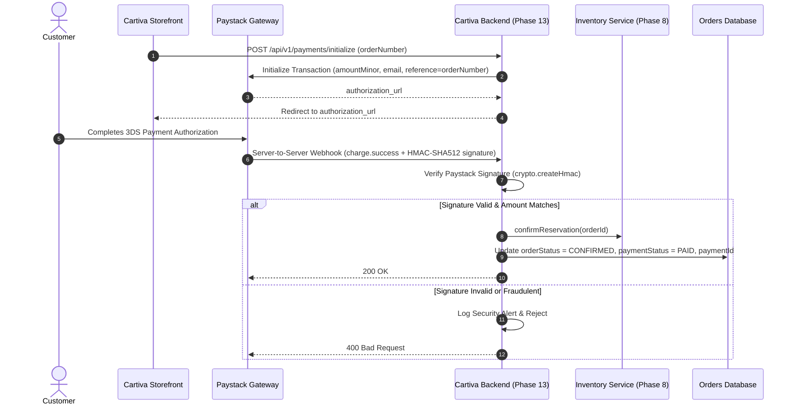

# Payment Integration Preparation & Phase 13 Boundary — Cartiva Mini (Phase 12)

## 1. Strict Phase Separation

In compliance with Cartiva Mini's architectural safety rules, **payment gateway integration belongs exclusively to Phase 13**.

Phase 12 establishes the complete checkout, validation, inventory reservation, and order creation pipeline without premature payment execution:

- **No Mock Payments:** Neither backend nor frontend claims that payment has been collected.
- **No Client Payment Claims:** The backend never accepts a payload stating `paymentStatus: "paid"`.
- **Order State Integrity:** All orders created in Phase 12 start in `OrderStatus.PENDING_PAYMENT` with `PaymentStatus.PENDING`.
- **Customer Transparency:** The checkout confirmation screen and order detail pages explicitly notify customers that payment settlement will occur in Phase 13.

---

## 2. Order Fields Prepared for Phase 13

Every order created in Phase 12 exposes the exact parameters needed by Paystack in Phase 13:

```typescript
{
  orderId: order._id.toString(),             // Internal DB ID
  orderNumber: order.orderNumber,           // Paystack transaction reference (ORD-YYYYMMDD-XXXXXX)
  email: customer.email,                    // Customer billing email
  amountMinor: order.totalAmountMinor,      // Amount in kobo (Paystack expects minor integer units)
  currency: order.currency,                 // 'NGN'
  reservationReference: order.reservationReference, // Phase 8 reservation reference
  metadata: {
    orderNumber: order.orderNumber,
    customerId: order.userId.toString(),
    cartItemCount: order.items.length,
  }
}
```

---

## 3. Phase 13 Payment Verification Contract

When Phase 13 activates the Paystack gateway, the order processing engine will integrate via the following lifecycle contract:



### Safety Guarantees:

1. **Idempotency:** Repeated webhooks for the same order reference must not duplicate stock deductions or write redundant confirmations.
2. **Signature Verification:** All Paystack webhook events must verify the `x-paystack-signature` header against the environment `PAYSTACK_SECRET_KEY`.
3. **No Card Data Storage:** Cartiva Mini never captures, processes, or stores raw credit/debit card numbers or CVVs on its servers.
