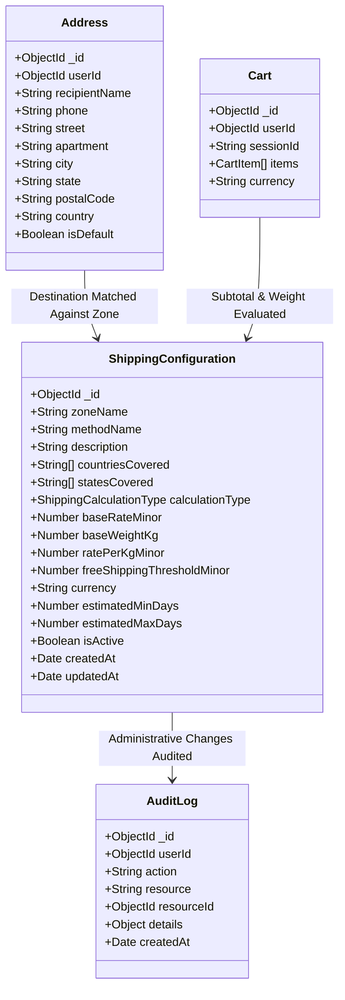

# Cartiva Mini — Shipping & Delivery Architecture

## 1. Executive Summary

Phase 11 introduces a robust, configurable, enterprise-grade shipping and delivery management system for Cartiva Mini. The system eliminates hardcoded shipping fees, static delivery estimates, and client-submitted pricing, enforcing authoritative server-side calculation backed by an administrative configuration engine and integer-minor-unit financial precision.

---

## 2. Architectural Principles

1. **Authoritative Server-Side Calculation:**
   - The client never dictates or submits shipping fees.
   - The backend validates the destination, examines active database configurations, calculates applicable rates (including weight tiers and free shipping thresholds), and returns the official quote.
2. **Database-Driven Configuration:**
   - Shipping methods, geographic service areas (countries and states/regions), rate calculation models, and delivery transit day estimates are stored in MongoDB (`ShippingConfiguration` collection).
   - Authorized administrators manage configurations via dedicated administrative endpoints.
3. **Integer Minor Unit Financial Representation:**
   - In accordance with Cartiva Mini's core architectural standards, all financial values (`baseRateMinor`, `ratePerKgMinor`, `freeShippingThresholdMinor`, `feeMinor`) are stored as 64-bit integer minor units (kobo/cents).
   - Floating-point arithmetic is strictly prohibited to prevent cumulative rounding discrepancies.
4. **Reuse of Existing Foundations:**
   - Customer addresses reuse the Phase 6 `Address` model (`Address.model.ts`). No duplicate address schemas or tables were introduced.
   - Cart subtotal and weight calculations seamlessly integrate with Phase 10 `Cart` and Phase 7 `Product` models.
   - Administrative mutations are permanently recorded in the Phase 4 `AuditLog` collection.
5. **No External Paid Dependencies:**
   - Distance calculations or external carrier APIs are not required. Regional matching operates on ISO country names, normalized state/region strings, and pattern-based zone matching.

---

## 3. Domain Model Architecture

---

## 4. Component Structure

The shipping subsystem is organized into a modular backend architecture under `backend/src/modules/shipping/`:

- **`shipping.constants.ts`:** Holds system defaults (`DEFAULT_CURRENCY = 'NGN'`, `DEFAULT_COUNTRY = 'Nigeria'`), supported Nigerian states list for autocomplete, and validation bounds.
- **`shipping.validator.ts`:** Zod schemas for query validation, quote calculation requests, and administrative configuration creation/updates.
- **`shipping.repository.ts`:** Encapsulates MongoDB queries, case-insensitive regex matching for states/countries, and compound index lookups.
- **`shipping.service.ts`:** Core calculation engine:
  - Resolves destination (either from guest input or customer's saved address).
  - Verifies address ownership to prevent Insecure Direct Object References (IDOR).
  - Matches active shipping zones.
  - Computes volumetric/dead weight and subtotal eligibility.
  - Applies flat rates, weight tiers, and free shipping thresholds.
  - Manages administrative CRUD with audit logging.
- **`shipping.controller.ts`:** Express handlers for customer quote requests, availability checks, and administrative CRUD operations.
- **`shipping.routes.ts`:** Customer/public endpoints mounted under `/api/v1/shipping`.
- **`admin-shipping.routes.ts`:** Admin endpoints mounted under `/api/v1/admin/shipping`, guarded by `authenticate` and `requireRole(UserRole.ADMIN)`.

---

## 5. Security and Tenant Isolation

1. **Address Ownership Enforcement:**
   - When an authenticated customer supplies `addressId` for a shipping quote, `shipping.service.ts` queries the address ensuring `address.userId.toString() === customer.id`.
   - If an unauthorized customer attempts to reference another user's address ID, the request is rejected with `403 Forbidden` (`ADDRESS_ACCESS_DENIED`).
2. **Administrative Access Control:**
   - All configuration mutation endpoints require a verified JWT with `UserRole.ADMIN`.
   - Requests from unauthenticated users or customers are blocked with `401 Unauthorized` or `403 Forbidden` (`FORBIDDEN`).
3. **Audit Trail:**
   - Every creation, update, status toggle, and deletion generates an immutable `AuditLog` entry storing the performing administrator's ID, action (`SHIPPING_CONFIG_CREATE`, `SHIPPING_CONFIG_UPDATE`, etc.), and modified fields.

---

## 6. Integration with Checkout (Phase 12 Preparation)

Phase 11 prepares the platform for Phase 12 Checkout by providing:

- Standardized `ShippingQuoteResponseDto` with selected method, fee in minor units, currency, and estimated delivery range.
- Authoritative validation endpoint `POST /api/v1/shipping/quotes` callable by the checkout pipeline before payment authorization.
- Zero client-side fee tampering guarantees.
