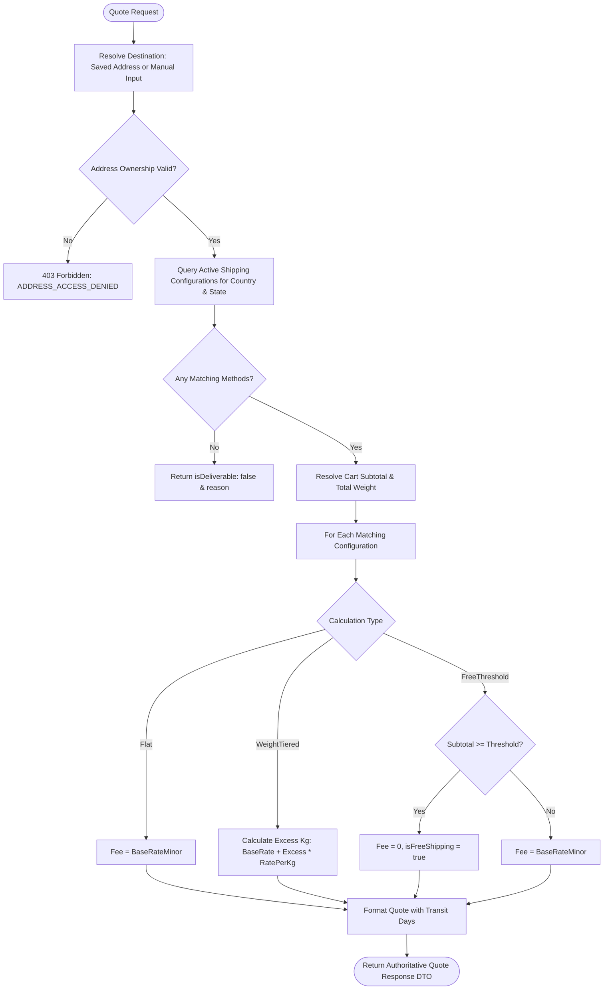

# Cartiva Mini — Shipping Calculation Engine

## 1. Calculation Philosophy

The Cartiva Mini Shipping Calculation Engine is designed around three strict commercial rules:

1. **Server Authority:** The backend calculates all shipping fees. The client never provides or overrides fee values.
2. **Integer Minor Unit Precision:** Financial computations use integer minor units (kobo/cents). Floating-point arithmetic is prohibited.
3. **Multi-Factor Evaluation:** The engine dynamically weighs cart subtotal, physical/billable weight, destination zones, and active methods to determine the exact shipping quote.

---

## 2. Algorithmic Workflow



---

## 3. Financial Precision & Mathematical Specifications

### 3.1 Currency Minor Units

All shipping rates in Cartiva Mini are calculated and stored in integer minor units:

- ₦1.00 = 100 minor units
- ₦2,500.00 = `250000` minor units
- ₦50,000.00 = `5000000` minor units

### 3.2 Weight Calculations

1. Each product in the catalog has an optional `weightGrams` field.
2. If `weightGrams` is undefined or 0, a default baseline of 500 grams (0.5 kg) is applied for shipping calculations.
3. Total cart weight in kilograms:
   $$\text{TotalWeightKg} = \sum_{i=1}^{n} \frac{\text{quantity}_i \times \text{weightGrams}_i}{1000}$$

### 3.3 Rate Formulas

#### 1. Flat Rate

$$\text{feeMinor} = \text{config.baseRateMinor}$$

#### 2. Weight-Tiered Rate

$$\text{excessKg} = \max\left(0, \left\lceil \text{totalWeightKg} - \text{config.baseWeightKg} \right\rceil\right)$$
$$\text{feeMinor} = \text{config.baseRateMinor} + (\text{excessKg} \times \text{config.ratePerKgMinor})$$

#### 3. Free Above Threshold

$$\text{feeMinor} = \begin{cases} 0 & \text{if subtotalMinor} \ge \text{config.freeShippingThresholdMinor} \\ \text{config.baseRateMinor} & \text{otherwise} \end{cases}$$

---

## 4. Unsupported Destinations & Fallback Handling

When a customer specifies a destination outside of any active service area:

- The system returns HTTP 200 with:
  ```json
  {
    "isDeliverable": false,
    "quotes": [],
    "message": "Delivery is currently unavailable to the selected destination."
  }
  ```
- The frontend renders an informative alert indicating that delivery is not yet supported for that location, preventing checkout lock-ins.
